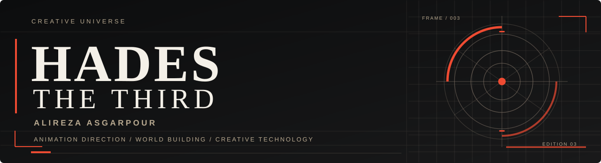

<picture>
  <source media="(prefers-color-scheme: dark)" srcset="assets/header-dark.svg" />
  <source media="(prefers-color-scheme: light)" srcset="assets/header-light.svg" />
  
</picture>

 

<a href="https://github.com/iAlirezaaa/iAlirezaaa/blob/main/README.md"><b>English</b></a> &nbsp; | &nbsp; <b>فارسی</b>

<h2 dir="rtl">هادس سوم | HADES THE THIRD</h2>

<b>داستان‌ها را کارگردانی می‌کنم، جهان‌های تازه می‌سازم و ابزارهایی برای آفرینندگان توسعه می‌دهم.</b>

---

## دربارهٔ سازندهٔ این جهان

من <b>علیرضا عسگرپور</b> هستم؛ کارگردان انیمیشن، روایتگر تصویری و توسعه‌دهندهٔ فناوری‌های خلاق.

کار من در نقطهٔ تلاقی <b>تولید انیمیشن، فیلم‌نامه‌نویسی، جهان‌سازی داستانی، ابزارهای سه‌بعدی، سیستم‌های هوشمند و نرم‌افزارهای خلاق</b> شکل می‌گیرد. هم به زبان سینما و کیفیت روایت اهمیت می‌دهم، هم به ابزارهایی که روند ساخت آثار را روشن‌تر، دقیق‌تر و قابل‌کنترل‌تر می‌کنند.

<b>HADES</b> نام جهان و قلمرو خلاق من است و <b>HADES THE THIRD</b> هویت سازنده و فرمانروای کنونی آن. پروژه‌هایم از داستان و تصویر تا ابزارهای متن‌باز و محیط‌های تعاملی امتداد دارند.

<blockquote dir="rtl">جهان بساز. به ایده‌ها شکل بده. خلق‌کردن را انسانی‌تر کن.</blockquote>

---

## پروژه‌های منتخب

چند نمونه از ریپوهای عمومی من در GitHub:

<table>
  <thead>
    <tr>
      <th align="right">پروژه</th>
      <th align="right">کاربرد و ایدهٔ اصلی</th>
    </tr>
  </thead>
  <tbody>
    <tr>
      <td align="right"><a href="https://github.com/iAlirezaaa/second-brain-os"><b>Second Brain OS</b></a></td>
      <td align="right" dir="rtl">محیط دانش و حافظهٔ پایدار، با رویکرد محلی‌محور، ابزارهای ایجنتی، ثبت منبع و روندهای قابل‌پیگیری.</td>
    </tr>
    <tr>
      <td align="right"><a href="https://github.com/iAlirezaaa/nodus"><b>Nodus</b></a></td>
      <td align="right" dir="rtl">محیط ایده‌پردازی و تفکر شبکه‌ای برای ارتباط مفاهیم، شاخه‌بندی و مدیریت پروژه‌های تو‌در‌تو.</td>
    </tr>
    <tr>
      <td align="right"><a href="https://github.com/iAlirezaaa/boardloom"><b>Boardloom</b></a></td>
      <td align="right" dir="rtl">بورد بصری تولید برای مدیریت تصاویر، شات‌ها، رفرنس‌ها و وظایف در پروژه‌های خلاق.</td>
    </tr>
    <tr>
      <td align="right"><a href="https://github.com/iAlirezaaa/typing-machine"><b>Digital Ink</b></a></td>
      <td align="right" dir="rtl">ماشین تحریر دیجیتال با حال‌وهوای نوستالژیک، پشتیبانی از فارسی و انگلیسی و امکان کار آفلاین؛ <a href="https://ialirezaaa.github.io/typing-machine/">نسخهٔ آنلاین</a>.</td>
    </tr>
    <tr>
      <td align="right"><a href="https://github.com/iAlirezaaa/veyra-browser"><b>Veyra</b></a></td>
      <td align="right" dir="rtl">محیط مرورگر محلی‌محور و دوزبانه برای سامان‌دهی تب‌ها، نشانک‌ها و آرشیو انتخابی گفت‌وگوهای هوش مصنوعی.</td>
    </tr>
    <tr>
      <td align="right"><a href="https://github.com/iAlirezaaa/CozyClay"><b>CozyClay</b></a></td>
      <td align="right" dir="rtl">ابزار متن‌باز پیش‌تولید سه‌بعدی برای چیدمان صحنه، برنامه‌ریزی حرکت و دوربین و تهیهٔ خروجی راهنما برای تولید ویدئو با هوش مصنوعی.</td>
    </tr>
  </tbody>
</table>

<i>سطح بلوغ پروژه‌ها یکسان نیست؛ بعضی از آن‌ها نمونه‌های اولیه یا در حال توسعه‌اند. برای آگاهی از وضعیت واقعی هر پروژه، README همان مخزن را ببینید.</i>

<a href="https://github.com/iAlirezaaa?tab=repositories"><b>مشاهدهٔ تمام ریپوهای عمومی</b></a> · <a href="https://ialirezaaa.github.io/fa/work/"><b>نمونه‌کارها</b></a>

---

## حوزه‌های تخصصی و ابزارها

<b>تولید انیمیشن و سه‌بعدی:</b> Maya، ZBrush، Unreal Engine، Nuke، فیلم‌برداری و پیش‌تولید بصری (Previs)

<b>مهندسی خلاق:</b> Python، JavaScript / TypeScript، React، Three.js، ابزارهای محلی‌محور و فرایندهای مبتنی بر هوش مصنوعی

---

## فعالیت در GitHub

  
   
  
   
  

<i>کارت‌های آماری به سرویس‌های عمومی شخص ثالث وابسته‌اند و ممکن است گاهی بارگذاری نشوند. مرجع اصلی فعالیت‌ها <a href="https://github.com/iAlirezaaa?tab=overview">صفحهٔ مشارکت‌های GitHub</a> است.</i>

---

## ارتباط با من

<a href="https://ialirezaaa.github.io/fa/">وب‌سایت شخصی</a> · <a href="https://ae.linkedin.com/in/ialirezaaa">لینکدین</a> · <a href="https://www.instagram.com/hades.3rd/">اینستاگرام</a> · <a href="https://t.me/Ialirezaaa">تلگرام</a> · <a href="https://t.me/AirisFeed">کانال خبری AirisFeed</a>

---

  HADES THE THIRD · STORY / SYSTEMS / WORLDS
   
  هویت مستقل هادس · رنگ شاخص Vermilion #EF4B32 · سربرگ تایپوگرافیک، نه جایگزین لوگوی اصلی
   
   
  <a href="https://github.com/iAlirezaaa/iAlirezaaa/blob/main/README.md">Read in English</a>

