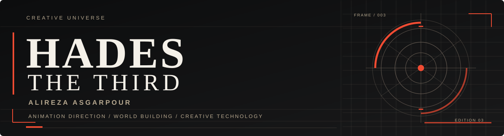

<picture>
  <source media="(prefers-color-scheme: dark)" srcset="assets/header-dark.svg" />
  <source media="(prefers-color-scheme: light)" srcset="assets/header-light.svg" />
  
</picture>

<b>English</b> &nbsp; | &nbsp; <a href="README.fa.md"><b>فارسی</b></a> &nbsp; · &nbsp; <a href="https://github.com/iAlirezaaa/iAlirezaaa/tree/fa">Persian branch (fa)</a>

 

**I direct stories, design worlds, and build tools for people who create.**

---

### The creator behind the realm

I am **Alireza Asgarpour** — an animation director, visual storyteller, and creative technologist.

My work connects **animation production, storytelling, worldbuilding, procedural tools, and agentic software**. I care about cinematic decisions and practical systems equally: tools should help creators think clearly, maintain continuity, and make better work.

**HADES** is the creative realm. **HADES THE THIRD** is its creator identity. The work spans original stories, visual experiences, and independent software projects.

> **Build worlds. Give ideas a form. Make the process more human.**

---

### Selected projects

Real public repositories from my GitHub account, with working project descriptions and current source code:

| Project | What it explores |
|:--|:--|
| **[Second Brain OS](https://github.com/iAlirezaaa/second-brain-os)** | A local-first knowledge and memory workspace with agent tools, provenance and accountable workflows. |
| **[Nodus](https://github.com/iAlirezaaa/nodus)** | A connected-thought workspace for branching ideas, nested projects and visual knowledge. |
| **[Boardloom](https://github.com/iAlirezaaa/boardloom)** | A visual production board for organizing image assets, shots, references and tasks. |
| **[Digital Ink](https://github.com/iAlirezaaa/typing-machine)** | A nostalgic, offline-capable typewriter for Persian and English. **[Try it](https://ialirezaaa.github.io/typing-machine/)** |
| **[Veyra](https://github.com/iAlirezaaa/veyra-browser)** | A local-first, bilingual Chromium workspace for tabs, bookmarks and opt-in AI chat archiving. |
| **[CozyClay](https://github.com/iAlirezaaa/CozyClay)** | Open-source previs: block a scene in a browser, plan camera and motion, then export guidance for AI video. |

*Projects have different maturity levels. Some are actively developed prototypes, not finished commercial products. Their repositories document current capabilities and limitations.*

[**Browse all public repositories**](https://github.com/iAlirezaaa?tab=repositories) · [**Visit the portfolio**](https://ialirezaaa.github.io/work/)

---

### Areas of practice

**Production & 3D:** Maya · ZBrush · Unreal Engine · Nuke · cinematography and previz

**Creative engineering:** Python · JavaScript / TypeScript · React · Three.js · local-first tooling · AI-assisted workflows

---

### GitHub activity

 

 

*Activity widgets use third-party public endpoints and may occasionally be unavailable; [GitHub's contribution history](https://github.com/iAlirezaaa?tab=overview) remains the source of truth.*

---

### In Persian · فارسی

**علیرضا عسگرپور** — کارگردان انیمیشن، طراح جهان داستانی و توسعه‌دهندهٔ ابزارهای خلاق.

«هادس» نام یک جهان خلاق است و «هادس سوم» هویت سازندهٔ آن. در اینجا پروژه‌هایی از روایت و تولید انیمیشن تا ابزارهای متن‌باز، هوش مصنوعی و نرم‌افزارهای خلاق را توسعه می‌دهم.

[وب‌سایت فارسی](https://ialirezaaa.github.io/fa/) · [گیت‌هاب](https://github.com/iAlirezaaa) · [کانال خبری AirisFeed](https://t.me/AirisFeed)

---

HADES THE THIRD · Story / Systems / Worlds
 
Vermilion accent #EF4B32 · Custom typographic headers; not a replacement for the original HADES brand marks.

